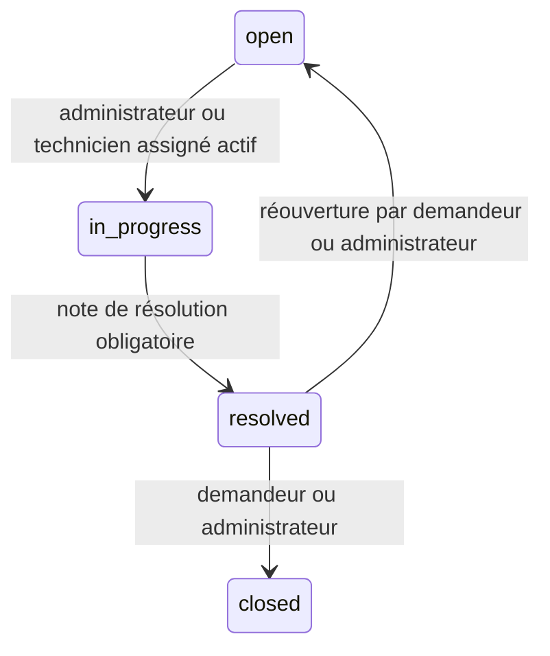

# Permissions et workflow des tickets

Contrat de `feature/ticket-workflow`. Authentification Sanctum par session et compte actif sur toutes les routes. Le périmètre reste : employé demandeur, technicien demandeur ou assigné, administrateur tous. Un ticket extérieur répond 404 avant validation ; un ticket visible mais une action interdite au rôle répond 403. Un état ou une donnée incompatible répond 422.

## Matrice

| Action | Demandeur, quel que soit son rôle | Technicien assigné non demandeur | Administrateur |
| --- | --- | --- | --- |
| Lire ticket, commentaires, historique | Oui | Oui | Oui |
| Corriger titre/description/catégorie | Seulement open non assigné | Non | Tout état sauf closed |
| Modifier priorité après création | Non, sauf rôle admin | Non | Tout état sauf closed |
| Affecter/réaffecter | Non, sauf rôle admin | Non | open ou in_progress |
| Retirer l’affectation | Non, sauf rôle admin | Non | open uniquement |
| Démarrer | S’il est aussi le technicien assigné ou admin | Oui | Oui |
| Résoudre | S’il est aussi le technicien assigné ou admin | Oui | Oui |
| Clôturer ou rouvrir depuis resolved | Oui | Non | Oui |
| Commenter | Oui sauf closed | Oui sauf closed | Oui sauf closed |

Les rôles admin indiqués dans la dernière colonne priment pour leurs propres demandes. Toute mutation de `closed` est refusée. Les règles d’état sont contrôlées après les autorisations de rôle ; un rôle interdit peut donc recevoir 403 sur un ticket clos, tandis qu’un acteur autorisé reçoit 422 pour l’état clos.

## États et dates UTC

Le démarrage exige un technicien actif de rôle `technician` actuellement assigné. La résolution fixe `resolved_at` et `resolution_note` (texte non blanc, maximum 10 000 caractères). La clôture fixe `closed_at`. La réouverture efface les dates de résolution/clôture et la note courante, **conserve l’affectation**, et ne supprime aucun événement ni commentaire. L’ancienne résolution reste dans les valeurs avant/après de l’historique. Une affectation conservée vers un compte devenu inactif devra être corrigée ou réactivée avant le prochain démarrage.

Une affectation ne démarre pas le ticket ; une réaffectation en cours conserve le statut. Retirer l’affectation est permis uniquement en état ouvert. Les transitions identiques et les autres raccourcis (open vers resolved, in_progress vers closed, etc.) répondent 422 pour un rôle autorisé.

## Policies, transactions et historique

`TicketPolicy` décide si le rôle peut effectuer l’action sur ce ticket visible. Elle évite qu’une action administrative soit obtenue simplement en forgeant une URL ou un champ. Les Form Requests vérifient le périmètre avant leurs validations, rejettent les clés inconnues et appliquent une validation partielle à PATCH.

`TicketMutation` ouvre une transaction et relit l’acteur puis le ticket sous verrou `FOR UPDATE`. Les services revérifient ensuite les autorisations et les conditions métier sur cet état courant. Les utilisateurs cibles et catégories sont également relus sous verrou lorsqu’ils interviennent. L’application utilise UTC et la connexion `mysql` fixe désormais `timezone: +00:00`, afin d’aligner les écritures et lectures des colonnes TIMESTAMP sur UTC (voir [la documentation MySQL sur les fuseaux de session](https://dev.mysql.com/doc/mysql-g11n-excerpt/8.0/en/time-zone-support.html)). Le connecteur Laravel installé prend en charge cette option ; la connexion réelle MySQL reste à vérifier localement. La transaction accepte jusqu’à cinq tentatives pour les erreurs de concurrence reconnues par Laravel.

Commenter et clôturer utilisent le même verrou de ticket : si la clôture a gagné, le commentaire voit l’état clos et échoue ; si le commentaire a gagné, il est enregistré avant la clôture. Un état observé auparavant dans une page ou un modèle en mémoire ne suffit jamais à autoriser une écriture. Aucun verrou de version ni HTTP 409 n’est ajouté. L’ordre de prise des verrous sur plusieurs utilisateurs peut provoquer un deadlock MySQL ; la transaction est alors annulée et retentée par Laravel, sans écriture partielle.

Chaque mutation écrit ses événements dans la même transaction. Si leur insertion échoue, l’affectation, le statut, la correction ou le commentaire sont annulés. Un PATCH général peut produire un événement `updated` pour les champs métier et un événement `priority_changed` distinct, tous deux atomiques. Les modifications et affectations identiques ne réécrivent pas le ticket et ne créent aucun événement fictif.

| Type | Valeurs utiles enregistrées |
| --- | --- |
| created | Métadonnées initiales existantes : statut, priorité, catégorie |
| updated | Avant/après des seuls champs titre, description, catégorie modifiés |
| priority_changed | Ancienne et nouvelle priorité |
| assignment_changed | Ancien et nouveau technician_id, nullable |
| status_changed | Avant/après statut, note et dates lors du démarrage |
| resolved | Avant/après avec nouvelle résolution et sa date |
| closed | Avant/après avec date de clôture |
| reopened | Avant avec ancienne résolution, après avec note/dates effacées |
| comment_added | Identifiant du commentaire dans after.comment_id |

Tous portent l’acteur et `occurred_at` côté serveur. Les nouveaux événements ont `metadata.before` et `metadata.after`. Les métadonnées des événements `created` historiques restent compatibles. Les événements ne peuvent pas être modifiés par l’API ; les commentaires n’ont pas encore d’édition ou de suppression. Leur lecture est réservée au périmètre du ticket et paginée 15 par défaut, 100 maximum, dans l’ordre chronologique.

## Recette API locale : création à clôture

Préparer une catégorie active et trois comptes actifs existants : un employé, un administrateur et un technicien. Les identifiants ci-dessous sont des variables à remplacer par les identifiants locaux. Utiliser **trois sessions de cookies distinctes**, obtenir `/sanctum/csrf-cookie` puis se connecter par `/api/login` pour chaque acteur. Envoyer le jeton CSRF correspondant sur les POST/PATCH ; aucun identifiant ou mot de passe n’est inclus dans ce document.

| Étape et acteur | Requête et contenu | Résultat attendu |
| --- | --- | --- |
| 1. Employé | POST `/api/v1/tickets`, title « Imprimante inaccessible », description « L’imprimante ne répond plus depuis ce matin. », category_id choisi | 201 ; retenir data.id ; open, technicien null, priorité normal, référence serveur, événement created |
| 2. Administrateur | PATCH `/tickets/{id}/assignment`, technician_id du technicien | 200 ; statut toujours open ; événement assignment_changed |
| 3. Technicien | PATCH `/tickets/{id}/status`, status in_progress | 200 ; événement status_changed |
| 4. Employé | POST `/tickets/{id}/comments`, content « Le problème concerne aussi les autres postes. » | 201 ; auteur employé et événement comment_added |
| 5. Technicien | POST `/tickets/{id}/comments`, content « Je vérifie la connexion au réseau. » | 201 ; auteur technicien |
| 6. Technicien | PATCH `/tickets/{id}/status`, status resolved, resolution_note « Connexion rétablie ; impression vérifiée. » | 200 ; resolved_at UTC et note courante ; événement resolved |
| 7. Employé | PATCH `/tickets/{id}/status`, status closed | 200 ; closed_at UTC ; événement closed |
| 8. Employé | GET `/tickets/{id}/comments` puis GET `/tickets/{id}/events` | 200 ; ordre chronologique, auteurs minimaux, historique complet |
| 9. Tout acteur visible | Tentative PATCH ou POST commentaire sur ce ticket clos | Refus 422 si rôle autorisé, sinon 403 ; aucune écriture ni événement supplémentaire |

Toutes les routes abrégées `/tickets/...` du tableau ont le préfixe `/api/v1`. Contrôler aussi qu’un autre employé reçoit 404, et qu’un compte désactivé subit le comportement existant `account_disabled` avec session invalidée.

## Recette distincte : réouverture avant clôture

Sur un nouveau ticket, reproduire les étapes 1 à 6 sans clôturer. Le demandeur envoie PATCH `/api/v1/tickets/{id}/status` avec `{ "status": "open" }`. Vérifier : statut open, même technicien assigné, `resolved_at`, `closed_at` et `resolution_note` nulls. GET `/events` doit conserver l’événement resolved et montrer l’ancienne note dans `reopened.metadata.before`.

Le technicien assigné actif peut redémarrer puis résoudre avec une nouvelle note. Le demandeur peut ensuite clôturer. Si le technicien est devenu inactif ou a changé de rôle, le redémarrage doit échouer en 422 tant qu’une affectation éligible n’a pas été rétablie. Ni la réouverture ni ce refus ne doivent supprimer l’historique antérieur.

Ces scénarios sont fournis pour la recette locale. Les vérifications réelles effectuées et leurs limites, notamment concurrence MySQL et navigateur avec cookies/CSRF, sont consignées dans [progression.md](progression.md).
